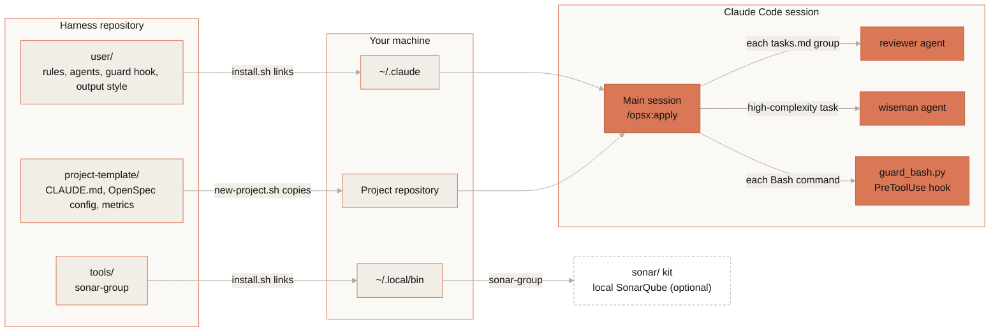

# Claude Code harness

This repository holds a harness for Claude Code: the global rules, the agents, the guard hook, the
output style, and the template that each new project gets. Clone it to any folder. Claude Code reads
it through symlinks in `~/.claude`, so an edit here takes effect in the next session of every project.

## System design



Each new session reads the harness through the links in `~/.claude`, so an edit in this repository
reaches every project. The main session sends each command to the guard, each group of `tasks.md` to
the reviewer, and each high-complexity task to the wiseman. The `sonar/` kit runs a local SonarQube
server for the optional gate.

## Contents

| Path | What it is | Where Claude Code reads it |
|---|---|---|
| `user/CLAUDE.md` | Global rules: comments, second opinion, session links | `~/.claude/CLAUDE.md` |
| `user/rules/lessons.md` | Lessons that apply to every project | `~/.claude/rules/` (Claude Code loads this folder by itself) |
| `user/agents/wiseman.md` | Independent second opinion for high-complexity tasks | `~/.claude/agents/` |
| `user/agents/reviewer.md` | Reviewer of each `tasks.md` group against the spec | `~/.claude/agents/` |
| `user/hooks/guard_bash.py` | `PreToolUse` guard: denies irreversible commands, asks on rare ones | `~/.claude/hooks/` |
| `user/hooks/test_guard_bash.py` | Tests of the guard | none |
| `user/output-styles/asd-ste100.md` | Simplified Technical English output style | `~/.claude/output-styles/` |
| `tools/sonar-group.mjs` | Optional SonarQube gate of a `tasks.md` group: blocks only the issues on the lines that the staged diff adds | `~/.local/bin/sonar-group` |
| `sonar/` | Optional local SonarQube kit: the server, the scan script that `sonar-group` calls, and an example config | `SONAR_HUB` |
| `project-template/` | `CLAUDE.md`, `openspec/config.yaml`, and the harness metrics for a new repository | copied by `new-project.sh` |
| `experiments/harness-v2.md` | One session per `tasks.md` group. Under test, not in the template. | none |

All files are in English. The harness metrics also read the Spanish words of an earlier version of
the template, so the history of projects that started with it still counts.

The hook registration stays in `~/.claude/settings.json`, because that file also holds settings of
other tools:

```json
{ "matcher": "Bash", "hooks": [{ "type": "command", "command": "/usr/bin/python3 -I \"$HOME/.claude/hooks/guard_bash.py\"" }] }
```

The guard writes its log to `~/.claude/hooks/guard-bash.log.jsonl`, outside this repository.

## Requirements

- Claude Code.
- `python3` for the guard hook.
- Node.js 22 or later for `sonar-group` and the harness metrics.
- Docker, `jq`, and `curl` for the `sonar/` kit.
- [OpenSpec](https://github.com/Fission-AI/OpenSpec) for the project template.

## Install on a machine

1. Clone the repository to a folder of your choice.
2. Run the install script from the clone. It links each file of `user/` into `~/.claude` at the same
   relative path. It moves each file that it replaces to `~/.claude/backups/harness-<time>/`. It
   also links each executable file of `tools/` into `~/.local/bin` (`HARNESS_BIN_DIR` changes it).

   ```bash
   ./install.sh
   ```

3. If `settings.json` has no `PreToolUse` entry for the guard, add the entry above.
4. Run the guard tests:

   ```bash
   python3 -m unittest user/hooks/test_guard_bash.py
   ```

**CAUTION:** The guard and the rules are opinions, not a security boundary. Read `guard_bash.py` and
the rules before you install them, and change them to fit your projects.

## SonarQube gate (optional)

`sonar-group` runs the scan of a local SonarQube server on the current worktree, then reads the issues
of the staged files. An issue is `new` when one of its locations touches a line that the staged diff
adds; a new file counts in full. Only `new` issues block (`gate=FAIL`, exit 1). The issues that were
already there are `previous` and do not block. The scan and the read run in one command, so the
analysis of another worktree cannot get between them. On macOS, `sonar-group` runs `caffeinate` until
it ends: on battery the Mac sleeps after one idle minute, and a sleep stops the scan.

```bash
git add -A
sonar-group <project-key> --version <change>-g<N>
```

The `sonar/` folder is a ready hub: set `SONAR_HUB` to it and follow `sonar/README.md` to start the
server and make the tokens. You can also supply your own hub folder. It must have an executable `scan.sh` with this
contract:

- Arguments: `scan.sh <project-key> <repository-root> <version>`.
- It analyzes the repository with `sonar-scanner` and sends the analysis to the server.
- It waits until the server has processed the analysis, then exits 0. On an error, it exits with a
  value that is not 0.
- It refuses to start when another scan runs, so two worktrees cannot mix their analyses.

The project key must exist on the server, with the quality profile and the exceptions of that project.

| Variable | Required | Default |
|---|---|---|
| `SONAR_HUB` | yes | none: the hub folder, the one that has `scan.sh`, for example `<clone>/sonar` |
| `SONAR_TOKEN_FILE` | no | `~/.config/sonar-group/token`: a file with a SonarQube analysis token |
| `SONAR_HOST_URL` | no | `http://127.0.0.1:9000` |

Set them in the shell profile, or in `.env.local` at the root of the repository. A value from the
environment wins over `.env.local`.

**WARNING:** Keep the token in a file outside every repository, with mode `600`. Do not put the token
in `.env.local`.

Run the tests with `node --test tools/*.test.mjs`.

## Start a new project

1. Copy the template. The script never overwrites a file.

   ```bash
   ./new-project.sh <path-to-repository>
   ```

2. In the new repository, run `openspec init`. It makes the `/opsx:*` commands and skills.
3. Fill the `<...>` placeholders in `CLAUDE.md` (with the section "Rules for the reviewer") and in
   `openspec/config.yaml`.
4. Add `"harness:metrics": "npx tsx scripts/harness-metrics.ts"` to `package.json`.

## Change the harness

- Edit the file here, commit, and push. A new session reads the change.
- A lesson that applies to every project goes to `user/rules/lessons.md`. A fact about one project
  stays in that project's memory or `CLAUDE.md`.
- A change to the guard gets a case in `test_guard_bash.py`.

**CAUTION:** Do not commit customer data, real ids, tokens, local paths, or facts that belong to one
employer's project. Keep those in the project repository.
